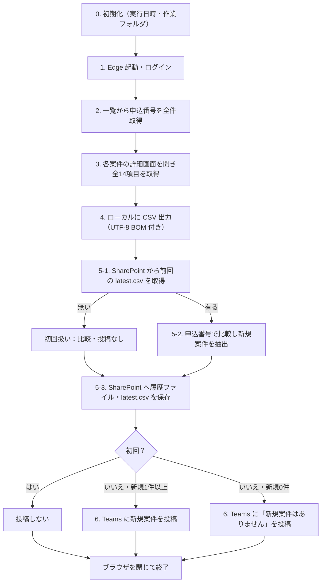

# フロー仕様（flow.md）

> 作成：Planner（元資料：`input/brief.md`）
> フローは **Power Automate Desktop（PAD）のデスクトップフロー1本**。クラウドフローは使わない。モック画面から PA を呼び出すこともしない。
> 作成は2スプリントに分ける（`04-flow-scrape`：手順0〜4、`05-flow-compare-notify`：手順5〜7）。最終成果物は1本のフロー。

---

## 0. 全体像

| 項目           | 内容                                                                                                                                    |
| -------------- | --------------------------------------------------------------------------------------------------------------------------------------- |
| フロー名       | 申込状況チェック\_デモ                                                                                                                  |
| 実行方法       | デモ担当者が PAD コンソールから手動実行                                                                                                 |
| 実行 PC        | フロー作成に使っている Windows PC（デモも同じ PC）                                                                                      |
| ブラウザ       | Microsoft Edge ＋ PAD のブラウザ拡張機能                                                                                                |
| 操作対象       | モック「申込管理システム（デモ）」（`http://localhost:8080`、`docs/screens.md`）。一覧画面のデモ操作エリア（`#demo-tools`）は操作しない |
| 出力           | SharePoint の所定ライブラリに CSV 2ファイル（日時付きの履歴ファイル＋`latest.csv`）                                                     |
| 通知           | Teams コネクタで作成者の個人チャットに投稿                                                                                              |
| 成果物の置き場 | `flows/`（PAD デザイナーに貼り付けられるアクション定義テキスト＋手順書）                                                                |
| 所要時間の目安 | 1回の実行が 3 分以内（20〜22件の詳細取得を含む）。デモの持ち時間が決まったら見直す【要確認：持ち時間】                                  |



- 前回 CSV の取得（5-1）は、必ず今回分の `latest.csv` を保存（5-3）する **前** に行う。

---

## 1. 変数

| 変数名（案）                                                | 内容                                                       | 設定方法                                                       |
| ----------------------------------------------------------- | ---------------------------------------------------------- | -------------------------------------------------------------- |
| `BaseUrl`                                                   | モックの URL（`http://localhost:8080`）                    | フロー先頭で固定値を設定                                       |
| `LoginId` / `LoginPassword`                                 | モックのダミー ID/PW（`docs/screens.md` S1）               | フロー先頭で固定値を設定（パスワードは機密テキストとして扱う） |
| `RunDateTime`                                               | 実行日時                                                   | 現在日時を取得                                                 |
| `RunStamp`                                                  | ファイル名用の日時（`YYYYMMDD_HHMM`）                      | `RunDateTime` を書式変換                                       |
| `WorkFolder`                                                | ローカルの作業フォルダ（ドキュメント配下の作業用フォルダ） | フロー先頭で設定。無ければ作成                                 |
| `HistoryFileName`                                           | `申込状況_<RunStamp>.csv`                                  | 組み立て                                                       |
| `ApplicationNos`                                            | 一覧から取得した申込番号のリスト                           | 手順2                                                          |
| `CurrentTable`                                              | 今回取得した全件（14列のデータテーブル）                   | 手順3                                                          |
| `PreviousExists`                                            | 前回 CSV の有無（真偽）                                    | 手順5-1                                                        |
| `PreviousNos`                                               | 前回 CSV の申込番号のリスト                                | 手順5-1                                                        |
| `NewRows`                                                   | 新規案件（`CurrentTable` の行のうち前回に無いもの）        | 手順5-2                                                        |
| `HistoryFileLink`                                           | SharePoint に保存した履歴ファイルへのリンク                | 手順5-3                                                        |
| `SharePointSite` / `SharePointLibrary` / `SharePointFolder` | 保存先                                                     | **作成時に PAD 上で設定。docs・flows には書かない**            |
| `ChatRecipient`                                             | 投稿先（作成者本人）                                       | **作成時に PAD 上で設定。docs・flows には書かない**            |

- `flows/` の定義テキストでは、SharePoint の保存先・Teams の投稿先・接続情報は `<作成時に設定>` のようなプレースホルダーにする。

---

## 2. 手順

### 手順0. 初期化

1. 実行日時を取得し、`RunStamp`（`YYYYMMDD_HHMM`）と `HistoryFileName` を作る。
2. `WorkFolder` が無ければ作る。
3. データテーブル `CurrentTable` を、見出し14列（`docs/screens.md` 1-2 の項目名・順番）で用意する。

### 手順1. Edge 起動・ログイン（スプリント04）

1. 新しい Microsoft Edge を起動し、`<BaseUrl>/login.html` を開く。
2. `#login-id` が表示されるまで待つ。
3. `#login-id` に `LoginId`、`#login-password` に `LoginPassword` を入力する。
4. `#login-button` をクリックする。
5. 一覧画面の `#application-table[data-loaded="true"]` が表示されるまで待つ（タイムアウト 30 秒）。

### 手順2. 一覧から申込番号を取得（スプリント04）

1. `#application-tbody` 内の全行 `tr[data-application-no]` から、申込番号（`data-application-no` 属性値）をリスト `ApplicationNos` として取得する。
2. `#application-count` の表示文字（「全 N 件」）を読み、数字（N）だけを取り出して、`ApplicationNos` の件数と一致することを確認する（不一致はエラー扱い）。
   - 理由：PAD 11.2609 の「Web ページ上の要素の詳細を取得します」で属性名に `data-count` を指定すると、エラーにならず空の文字が返る（実機で確認）。属性名を Own Text にすると表示文字「全 20 件」が取れるため、こちらを使う。
   - モックの `data-count` 属性は画面仕様として残す（`docs/screens.md` S2）が、フローでは読まない。セレクターは `#application-count` のままで、表示文字に依存したセレクターにはしない。

### 手順3. 各案件の詳細を取得（スプリント04）

`ApplicationNos` の各申込番号について繰り返す：

1. 一覧画面で `button[data-action="detail"][data-application-no="<申込番号>"]` をクリックする。
2. 詳細画面の `#application-detail[data-loaded="true"]` が表示されるまで待つ。
3. `#field-applicationNo` の値が対象の申込番号と一致することを確認する（不一致はエラー扱い）。
4. 14項目を `#field-<キー>` から取得し、`CurrentTable` に1行追加する。値は画面に表示されたテキストのまま（「未定」「未採番」、空欄の備考を含む）。
5. `#back-to-list-button` をクリックし、`#application-table[data-loaded="true"]` を待つ。

- 「詳細」ボタンで遷移すること（デモで「一覧 → 詳細を順に開く」様子を見せるため）。URL 直接指定での遷移は使わない。
- 全件分が終わったらブラウザはまだ閉じない（最後に閉じる）。

### 手順4. ローカルに CSV 出力（スプリント04）

1. `CurrentTable` を `WorkFolder\<HistoryFileName>` に書き出す。
   - 文字コード：UTF-8（BOM 付き）。Excel で開いて文字化けしないこと。
   - 1行目は見出し（項目名、`docs/screens.md` 1-2 の順）。区切りはカンマ。
2. 同じ内容を `WorkFolder\latest.csv` にも書き出す（SharePoint へ保存する用）。

### 手順5. 前回との比較（スプリント05）

**5-1. 前回 CSV の取得**

1. SharePoint の保存先から `latest.csv` の内容を取得し、`WorkFolder\previous.csv` に保存する。
2. 取得できなかった（ファイルが無い）場合は `PreviousExists = false` とし、5-2 を飛ばす。
3. 取得できた場合は CSV を読み込み（見出し行あり・UTF-8）、申込番号列を `PreviousNos` とする。

**5-2. 新規案件の抽出**

1. `CurrentTable` の各行について、申込番号が `PreviousNos` に **含まれない** 行を `NewRows` に入れる。
2. 判定は申込番号のみで行う（ステータス変更などの検知は範囲外）。

**5-3. SharePoint への保存**

1. `WorkFolder\<HistoryFileName>` を保存先にアップロードする。
2. `WorkFolder\latest.csv` を保存先にアップロードし、既存の `latest.csv` を上書きする（上書きできないアクションの場合は、ファイル内容の更新アクションを使う。作成時に確認）。
3. 履歴ファイルへのリンクを `HistoryFileLink` に保持する。

- 同じ分に2回実行した場合、履歴ファイルは上書きされてよい。

### 手順6. Teams 投稿（スプリント05）

Teams コネクタ（デスクトップフローのクラウドコネクタ）のチャット投稿アクションで、作成者本人の個人チャット（Flow ボットとのチャット等）に投稿する。

| 条件                             | 投稿                   |
| -------------------------------- | ---------------------- |
| 初回（`PreviousExists = false`） | **投稿しない**         |
| 新規1件以上                      | 下記「新規あり」の文面 |
| 新規0件                          | 下記「新規0件」の文面  |

**新規ありの文面（例）**

```
【申込状況チェック】新規案件が 2 件あります（取得日時：2026/10/14 10:30／全 22 件）

1. DM-2026-0022／サンプル 二郎／契約容量変更／40A → 60A／受付済
2. DM-2026-0021／見本 三郎／契約電力変更／30kW → 40kW／受付済

CSV：<履歴ファイルへのリンク>
```

**新規0件の文面（例）**

```
【申込状況チェック】新規案件はありません（取得日時：2026/10/14 10:45／全 22 件）

CSV：<履歴ファイルへのリンク>
```

- 各案件に含める項目：申込番号・お客さま名・申込種別・変更前容量 → 変更後容量・ステータス（brief 指定）。
- 新規0件時も CSV リンクを付ける。

### 手順7. 終了

1. ブラウザ（Edge）を閉じる。
2. 作業フォルダの一時ファイル（`previous.csv`）は残してよい（デモ後の確認用）。

---

## 3. セレクター方針

| 方針          | 内容                                                                                                                                                                                      |
| ------------- | ----------------------------------------------------------------------------------------------------------------------------------------------------------------------------------------- |
| 使う属性      | `docs/screens.md` 1-1・各画面の `id` / `data-*` のみを使う                                                                                                                                |
| 使わないもの  | 表示テキスト、行番号（`nth-child`）、CSS クラス、要素の階層位置に依存したセレクター。一覧画面のデモ操作エリア（`#demo-tools`、`demo-` で始まる id、`data-demo-action`）は操作・取得しない |
| 行の特定      | `data-application-no="<申込番号>"`（変数で組み立てる）                                                                                                                                    |
| 値の取得      | `#field-<キー>`（詳細）、`td[data-field="<キー>"]`（一覧）                                                                                                                                |
| 待機          | 画面遷移後は必ず `data-loaded="true"` の要素の出現を待ってから操作・取得する（固定秒数の待機に頼らない）                                                                                  |
| UI 要素の登録 | PAD の UI 要素はセレクターを手動で上記の形に編集し、自動生成された位置依存のセレクターは残さない                                                                                          |

- モック側で属性名を変える場合は、先に `docs/screens.md` を更新し、フロー側を合わせる。

---

## 4. エラー時の扱い

エラー時の再実行は範囲外（brief 11）。デモ当日に **間違った結果を残さない・状況がわかる** ことを優先する。

| 場面                                                               | 扱い                                                                                                                                 |
| ------------------------------------------------------------------ | ------------------------------------------------------------------------------------------------------------------------------------ |
| モックが起動していない／ログイン画面が開かない                     | 処理を止め、「モック画面に接続できません。server.js が起動しているか確認してください」をメッセージ表示                               |
| ログイン後に一覧が表示されない（タイムアウト）                     | 処理を止め、どの手順で止まったかをメッセージ表示                                                                                     |
| 詳細画面の取得失敗・申込番号の不一致・件数の不一致                 | 処理を止め、対象の申込番号をメッセージ表示。**SharePoint への保存・Teams 投稿は行わない**（`latest.csv` を壊さないため）             |
| 前回 `latest.csv` が無い                                           | エラーではなく初回扱い（投稿しない）                                                                                                 |
| 前回 `latest.csv` の取得が「無い」以外の理由で失敗（接続エラー等） | 処理を止め、メッセージ表示。初回扱いにはしない（誤って `latest.csv` を上書きしないため）                                             |
| SharePoint への保存失敗                                            | 処理を止め、メッセージ表示。Teams 投稿は行わない                                                                                     |
| Teams 投稿失敗                                                     | メッセージ表示して終了（CSV は保存済み。再実行すると新規0件になる点に注意。デモでは `docs/demo-script.md` 1-2 のリセット手順で戻す） |
| どの場合も                                                         | 最後にブラウザを閉じる処理を試みる                                                                                                   |

- メッセージ表示はデモ操作者が見るためのもの。PAD のエラー処理（ブロックのエラー時処理）で手順ごとに分ける。

---

## 5. 前提条件（作成時に確認）

- 会社のアカウント（Microsoft 365）で PAD にサインインしていること。
- クラウドコネクタ（Teams・SharePoint）の接続作成に WebView2 が必要。
- 社内ネットワークで、コネクタの通信先が許可されていること。
- Teams コネクタは Web 版で利用実績あり。デスクトップ版での利用可否は作成時に確認。
- SharePoint コネクタの接続作成の前提条件（Teams と同様）、保存先のサイト・ライブラリ。【要確認】
- PAD の Edge 拡張機能がインストール・有効化されていること。

---

## 前提・確認事項

| #   | 内容                                                                                                                           | 状態                    |
| --- | ------------------------------------------------------------------------------------------------------------------------------ | ----------------------- |
| 1   | **SharePoint の保存先サイト・ライブラリ（フォルダ）、SharePoint コネクタ接続の前提条件**（URL 等は docs に書かない）           | 【要確認】              |
| 2   | Teams 投稿は「Flow ボットから作成者本人へのチャット」を想定。デスクトップフローの Teams コネクタで投稿できるか、投稿元の表示名 | 作成時に確認            |
| 3   | デモの持ち時間（1回の実行を 3 分以内とする目安はこれに合わせて見直す）                                                         | 【要確認】              |
| 4   | `latest.csv` の上書き方法（作成アクションで上書きできるか、更新アクションを使うか）                                            | 作成時に確認            |
| 5   | 画面項目は brief の項目を採用（実際の画面項目は未確認）                                                                        | 【要確認】              |
| 6   | 新規0件の投稿にも CSV リンクを付ける、リンクは履歴ファイルを指す、作業フォルダの場所、接続エラー時は初回扱いにせず止める       | 確定（レビュー①で了承） |
