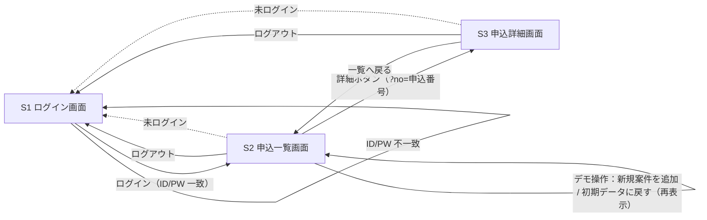

# 画面仕様（screens.md）

> 作成：Planner（元資料：`input/brief.md`）／人のレビュー①を反映済み
> 対象：架空の「申込管理システム（デモ）」。送配電側のシステムを模したモック画面で、Power Automate Desktop（以下 PAD）が画面操作して情報を取得する対象。
> 実在の社名・システム名・ロゴ・デザインは使わない。データはすべて `mock/data/dummy.json` の架空データ。

---

## 0. スプリント順

1スプリント = 1画面 または フローの1区切り。各スプリントは `main` から `sprint/<NN>-<スラッグ>` を切って行う。

| 順  | スプリント（フォルダ名）         | 作るもの                                                                                                                                              | 主な合格イメージ                                                                                        | 依存                             |
| --- | -------------------------------- | ----------------------------------------------------------------------------------------------------------------------------------------------------- | ------------------------------------------------------------------------------------------------------- | -------------------------------- |
| 01  | `01-list-screen`（既存フォルダ） | `server.js`（Node 標準機能のみ）、`dummy.json` の初期データ20件、申込一覧画面、一覧画面の「デモ操作」エリア（「新規案件を追加」「初期データに戻す」） | `http://localhost:8080/list.html` で20件がページ送りなしで表示される。ボタンで1件追加・初期20件に戻せる | なし                             |
| 02  | `02-login-screen`                | ログイン画面、未ログイン時のガード、ログアウト                                                                                                        | 固定 ID/PW でログインすると一覧に移る。誤りはエラー表示。未ログインで一覧を開くとログインへ戻る         | 01                               |
| 03  | `03-detail-screen`               | 申込詳細画面、一覧の「詳細」ボタン遷移、「一覧へ戻る」                                                                                                | 一覧の任意行から該当の詳細に遷移し、全14項目が表示される                                                | 01, 02                           |
| 04  | `04-flow-scrape`                 | PAD フロー前半（ログイン → 一覧 → 全件の詳細取得 → ローカル CSV 出力）                                                                                | 定義テキストと手順書が `flows/` にあり、セレクターが本書の命名と一致している                            | 01〜03                           |
| 05  | `05-flow-compare-notify`（保留・付加価値） | 4＋α の別資産 `flows/application-check-notify/`（SharePoint 保存・前回 CSV 取得・新規判定・Teams 投稿）。デモ版の対象外                  | （保留）初回／新規あり／新規0件 の3分岐が定義されている                                                 | 04、SharePoint・Teams 接続の確認 |

- 「新規案件を追加」「初期データに戻す」は **01 に含める**。理由：
  - データを `dummy.json` に保存する処理は `server.js` の役割で、01 で作る配信・読み込みと一緒に作るほうが手戻りが少ない。
  - 「件数が増える／20件に戻る」を一覧の表示で確かめられるので、01 の採点で完結する。
  - 03 の後に回すと、そのためだけのスプリントが1つ増える（5つに収まらない）。
  - 懸念：01 の作業量がやや多い。差し戻しが続く場合は、デモ操作エリアを 03 の後の追加スプリントに切り出す。
- 人の決定（2026-10-20）：デモ版はスプリント04d までを正とする。04 がデモ本編の PAD フロー（ログイン → 一覧 → 全件の詳細取得 → ローカル CSV 出力）。05（SharePoint 保存・前回比較・Teams 投稿）は別資産 `flows/application-check-notify/` の「保留（付加価値）」で、4＋α の位置づけ。PAD での実行確認は Evaluator の範囲外のため、人のレビュー②で行う。

---

## 1. 共通仕様

| 項目           | 内容                                                                                                                 |
| -------------- | -------------------------------------------------------------------------------------------------------------------- |
| 配信           | `server.js`（Node 標準機能のみ）で `http://localhost:8080` から配信                                                  |
| ブラウザ       | Microsoft Edge（PAD のブラウザ拡張機能を使用）                                                                       |
| 画面タイトル   | 全画面のヘッダーに「申込管理システム（デモ）」と表示。ブラウザタブのタイトルは「申込管理システム（デモ）- <画面名>」 |
| データ         | `mock/data/dummy.json`。追加したデータもこのファイルに保存する。初期データ（20件）はリセット用に別に保持する         |
| 件数           | 初期20件。ページ送りなし（追加後は21件以上を全件1ページに表示）                                                      |
| 並び順         | 申込番号の降順（新しい案件が上）。表示のたびに順序が変わらないこと                                                   |
| 認証           | ダミー認証。固定 ID/PW（S1 参照）。ログイン状態はブラウザのタブ単位で保持し、ログアウトまたはタブを閉じると解除      |
| 文言           | 日本語                                                                                                               |
| 未設定値の表示 | 工事予定日が未定の場合は「未定」、送配電受付番号が未採番の場合は「未採番」、備考が無い場合は空欄                     |
| データの制約   | CSV で崩れないよう、値にカンマ・改行・ダブルクォートを含めない                                                       |

### 1-1. PAD 向けの属性命名ルール（全画面共通）

| 目的                     | 命名                                                                                                                              | 例                                            |
| ------------------------ | --------------------------------------------------------------------------------------------------------------------------------- | --------------------------------------------- |
| 画面の識別               | `<body data-page="...">`                                                                                                          | `data-page="login"` / `"list"` / `"detail"`   |
| 読み込み完了の目印       | 画面のデータ表示が終わったら、対象要素に `data-loaded="true"` を付ける（PAD はこれを待つ）                                        | `#application-table[data-loaded="true"]`      |
| 操作対象（入力・ボタン） | `id` はケバブケース、役割がわかる英語                                                                                             | `login-id`, `login-button`                    |
| 取得対象（項目値）       | `data-field="<項目キー>"`（キーは下の項目表のキー名、キャメルケース）                                                             | `data-field="applicationNo"`                  |
| 行の識別                 | `data-application-no="<申込番号>"`                                                                                                | `data-application-no="DM-2026-0001"`          |
| 業務ボタンの種類         | `data-action="<動作>"`                                                                                                            | `data-action="detail"`                        |
| デモ操作用の要素         | `id` は `demo-` で始め、ボタンは `data-demo-action="<動作>"`。**`data-field` / `data-application-no` / `data-action` は付けない** | `id="demo-add-button" data-demo-action="add"` |

- `id` / `data-*` は表示ごとに変わらないこと（連番やランダム値を使わない。行は申込番号で識別する）。
- 項目値はラベルと別の要素に入れ、値の要素のテキストだけで取得できること（例：ラベル「申込番号」と値「DM-2026-0001」が同じテキストノードに混ざらない）。

### 1-2. 項目定義（一覧・詳細・CSV で共通）

| #   | 項目名（画面・CSV 見出し） | キー                | 型                                                     | 必須       | サンプル値（架空）          | 一覧 | 詳細 |
| --- | -------------------------- | ------------------- | ------------------------------------------------------ | ---------- | --------------------------- | ---- | ---- |
| 1   | 申込番号                   | `applicationNo`     | 文字列（`DM-YYYY-NNNN`）                               | 必須・一意 | DM-2026-0001                | ○    | ○    |
| 2   | 申込日                     | `applicationDate`   | 日付（`YYYY/MM/DD`）                                   | 必須       | 2026/09/01                  | ○    | ○    |
| 3   | お客さま名                 | `customerName`      | 文字列                                                 | 必須       | サンプル 一郎               | ○    | ○    |
| 4   | 供給地点特定番号           | `supplyPointNo`     | 数字22桁（架空であることがわかるよう `99` 始まり）     | 必須       | 9900000000000000000001      | ○    | ○    |
| 5   | 申込種別                   | `applicationType`   | 選択値（契約容量変更／契約電力変更／新設）             | 必須       | 契約容量変更                | ○    | ○    |
| 6   | 変更前容量                 | `capacityBefore`    | 文字列（単位付き。新設は「-」）                        | 必須       | 40A                         | ○    | ○    |
| 7   | 変更後容量                 | `capacityAfter`     | 文字列（単位付き）                                     | 必須       | 50A                         | ○    | ○    |
| 8   | ステータス                 | `status`            | 選択値（受付済／審査中／工事日調整中／工事予定／完了） | 必須       | 審査中                      | ○    | ○    |
| 9   | 担当者                     | `assignee`          | 文字列（顧客側の担当者。架空の人名）                   | 必須       | デモ 花子                   | ○    | ○    |
| 10  | 需要場所住所               | `siteAddress`       | 文字列（架空住所）                                     | 必須       | デモ県サンプル市見本町1-2-3 | -    | ○    |
| 11  | 希望日                     | `desiredDate`       | 日付（`YYYY/MM/DD`）                                   | 必須       | 2026/10/20                  | -    | ○    |
| 12  | 工事予定日                 | `scheduledWorkDate` | 日付 または「未定」                                    | 任意       | 2026/10/25                  | -    | ○    |
| 13  | 送配電受付番号             | `receptionNo`       | 文字列（`UK-NNNNNNNN`。未採番は「未採番」）            | 任意       | UK-00012345                 | -    | ○    |
| 14  | 備考                       | `remarks`           | 文字列（空欄可）                                       | 任意       | 立会い希望あり              | -    | ○    |

- brief にある送配電側の受付番号は、docs では実在社名を避けて「送配電受付番号」と呼び、画面文言もこの名称にする。
- 初期データ20件は、申込種別・ステータスがばらけるように作る（例：契約容量変更 14件、契約電力変更 3件、新設 3件／完了・工事予定・審査中などを混在）。

---

## 2. 画面一覧

| #   | 画面         | パス                                            | `data-page` | 誰が使う                                      |
| --- | ------------ | ----------------------------------------------- | ----------- | --------------------------------------------- |
| S1  | ログイン画面 | `/login.html`（`/` を開くとログイン画面を表示） | `login`     | PAD・デモ操作者                               |
| S2  | 申込一覧画面 | `/list.html`                                    | `list`      | PAD・デモ操作者（デモ操作エリアは操作者のみ） |
| S3  | 申込詳細画面 | `/detail.html?no=<申込番号>`                    | `detail`    | PAD・デモ操作者                               |

- 全ファイルでこのパスを使う（一覧画面は `/list.html`）。

---

## 3. 画面詳細

### S1. ログイン画面

| 項目             | 型                       | 必須 | サンプル値                               | 属性                  |
| ---------------- | ------------------------ | ---- | ---------------------------------------- | --------------------- |
| ログインID       | テキスト入力             | 必須 | demo-user                                | `id="login-id"`       |
| パスワード       | パスワード入力           | 必須 | demo-pass                                | `id="login-password"` |
| エラーメッセージ | テキスト（通常は非表示） | -    | 「IDまたはパスワードが正しくありません」 | `id="login-error"`    |

| ボタン   | 属性                | 動作・遷移先                                                                    |
| -------- | ------------------- | ------------------------------------------------------------------------------- |
| ログイン | `id="login-button"` | ID/PW が固定値と一致 → S2。不一致・未入力 → `#login-error` を表示し画面に留まる |

- 固定 ID/PW は demo-user / demo-pass（デモ用のダミー。実在の認証情報ではない）。
- 既にログイン済みでもログイン画面はフォームを表示する（自動で一覧に飛ばない）。PAD が毎回同じ手順で操作できるようにするため。
- Enter キーでもログインできてよいが、PAD はボタンのクリックで操作する。

### S2. 申込一覧画面

画面は上から「ヘッダー」「業務エリア（件数・一覧表）」「デモ操作エリア（画面下部）」の3つに分ける。

**業務エリア（PAD の取得対象）**

| 要素             | 内容                                                                                                                     | 属性                                                                |
| ---------------- | ------------------------------------------------------------------------------------------------------------------------ | ------------------------------------------------------------------- |
| 件数表示         | 「全 20 件」                                                                                                             | `id="application-count"`, `data-count="20"`                         |
| 一覧表           | 列：申込番号／申込日／お客さま名／供給地点特定番号／申込種別／変更前容量／変更後容量／ステータス／担当者／（詳細ボタン） | `<table id="application-table">`、表示完了後に `data-loaded="true"` |
| 表の本体         | 全件の行                                                                                                                 | `<tbody id="application-tbody">`                                    |
| 行               | 1案件                                                                                                                    | `<tr data-application-no="DM-2026-0001">`                           |
| セル             | 各項目の値                                                                                                               | `<td data-field="applicationNo">` など（1-2 のキー）                |
| ログイン中の表示 | 「demo-user でログイン中」（ヘッダー）                                                                                   | `id="current-user"`                                                 |

| ボタン                 | 属性                                                                                        | 動作・遷移先                                       |
| ---------------------- | ------------------------------------------------------------------------------------------- | -------------------------------------------------- |
| 詳細（各行）           | `data-action="detail"`, `data-application-no="<申込番号>"`, `id="detail-button-<申込番号>"` | S3（`/detail.html?no=<申込番号>`）へ同じタブで遷移 |
| ログアウト（ヘッダー） | `id="logout-button"`                                                                        | ログイン状態を解除して S1 へ                       |

**デモ操作エリア（画面下部。デモ操作者のみ使う。PAD は触らない）**

| 要素           | 内容                                                                                               | 属性                        |
| -------------- | -------------------------------------------------------------------------------------------------- | --------------------------- |
| エリア全体     | 見出し「デモ操作（デモ用の機能です）」。枠線・背景色で業務エリアと見た目を分ける。一覧表の外に置く | `<section id="demo-tools">` |
| 結果メッセージ | 「DM-2026-0021 を追加しました」「初期データ（20件）に戻しました」                                  | `id="demo-message"`         |

| ボタン                   | 属性                                                                 | 動作                                                                                                                                                                                                                             |
| ------------------------ | -------------------------------------------------------------------- | -------------------------------------------------------------------------------------------------------------------------------------------------------------------------------------------------------------------------------- |
| 新規案件を追加           | `id="demo-add-button"`, `data-demo-action="add"`                     | 架空の案件を1件追加し `dummy.json` に保存。一覧と件数表示を再表示する（再表示完了後に `data-loaded="true"`）。申込番号は既存の最大番号+1、申込日は当日、ステータスは「受付済」、工事予定日は「未定」、送配電受付番号は「未採番」 |
| 初期データに戻す         | `id="demo-reset-button"`, `data-demo-action="reset"`                 | デモ操作エリア内に確認表示「初期データ（20件）に戻します。よろしいですか？」を出す                                                                                                                                               |
| 実行する（確認表示内）   | `id="demo-reset-confirm-button"`, `data-demo-action="reset-confirm"` | `dummy.json` を初期20件に戻し、一覧と件数表示を再表示する。確認表示を閉じる                                                                                                                                                      |
| キャンセル（確認表示内） | `id="demo-reset-cancel-button"`, `data-demo-action="reset-cancel"`   | 何もせず確認表示を閉じる                                                                                                                                                                                                         |

- 確認はブラウザ標準のダイアログ（`confirm`）ではなく画面内の表示で行う（Playwright MCP での採点ツールにダイアログ操作が含まれていないため、また画面共有で見やすくするため）。

- デモ操作エリアの要素には `data-field` / `data-application-no` / `data-action` を付けない（PAD の取得・操作対象と混ざらないようにするため）。
- 追加される案件の内容（お客さま名・種別・容量など）は、あらかじめ用意した追加候補（5件）から順番に使う。ランダムにしない（デモの再現性のため）。候補を使い切ったら先頭に戻り、申込番号だけ進める。
- サーバーを再起動しても、追加済みデータは残る（`dummy.json` に保存されているため）。
- 未ログインで開いた場合は S1 へ移動する（スプリント02 で追加）。
- データ取得に失敗した場合は `id="list-error"` に「データを読み込めませんでした」を表示する（`data-loaded` は付けない）。
- 新規追加された案件に「NEW」等の目印は付けない（新規の判定は PAD 側の役割であることを見せるため）。

### S3. 申込詳細画面

| 要素             | 内容                                             | 属性                                                                                                        |
| ---------------- | ------------------------------------------------ | ----------------------------------------------------------------------------------------------------------- |
| 画面見出し       | 「申込詳細（DM-2026-0001）」                     | `id="detail-title"`                                                                                         |
| 詳細表示         | 1-2 の全14項目をラベルと値で表示（定義リスト等） | 外枠 `id="application-detail"`、表示完了後に `data-loaded="true"`                                           |
| 各項目の値       | 値のみ                                           | `id="field-<キー>"` かつ `data-field="<キー>"`（例：`id="field-applicationNo" data-field="applicationNo"`） |
| エラーメッセージ | 該当なし時「該当する申込が見つかりません」       | `id="detail-error"`                                                                                         |

| ボタン     | 属性                       | 動作・遷移先 |
| ---------- | -------------------------- | ------------ |
| 一覧へ戻る | `id="back-to-list-button"` | S2 へ        |
| ログアウト | `id="logout-button"`       | S1 へ        |

- 未ログインで開いた場合は S1 へ移動する。
- 表示する項目の順番は 1-2 の # 順（CSV の列順と同じ）。
- 詳細画面にはデモ操作エリアを置かない。

---

## 4. 画面遷移図

---

## 前提・確認事項

| #   | 内容                                                                                                                                  | 状態                    |
| --- | ------------------------------------------------------------------------------------------------------------------------------------- | ----------------------- |
| 1   | 画面項目は brief の項目をそのまま採用。**実際の送配電側システムの画面にある項目、デモで見せたい項目**                                 | 【要確認】              |
| 2   | 番号の形式、申込種別・ステータスの選択値、ID/PW（demo-user / demo-pass）、ポート 8080、各パス名、並び順、NEW 目印なし、担当者＝顧客側 | 確定（レビュー①で了承） |
| 3   | 「新規案件を追加」「初期データに戻す」は一覧画面下部のデモ操作エリアに置き、スプリント01 で作る                                       | 確定（レビュー①）       |
